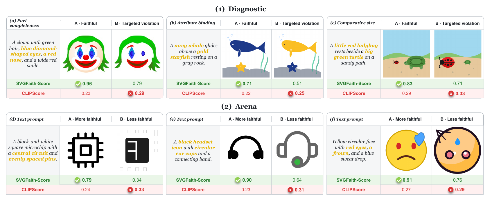
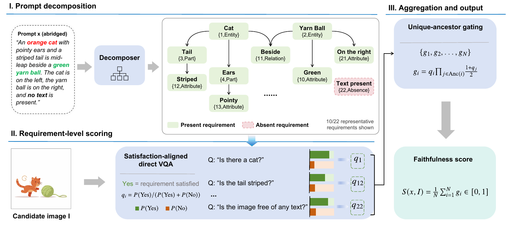
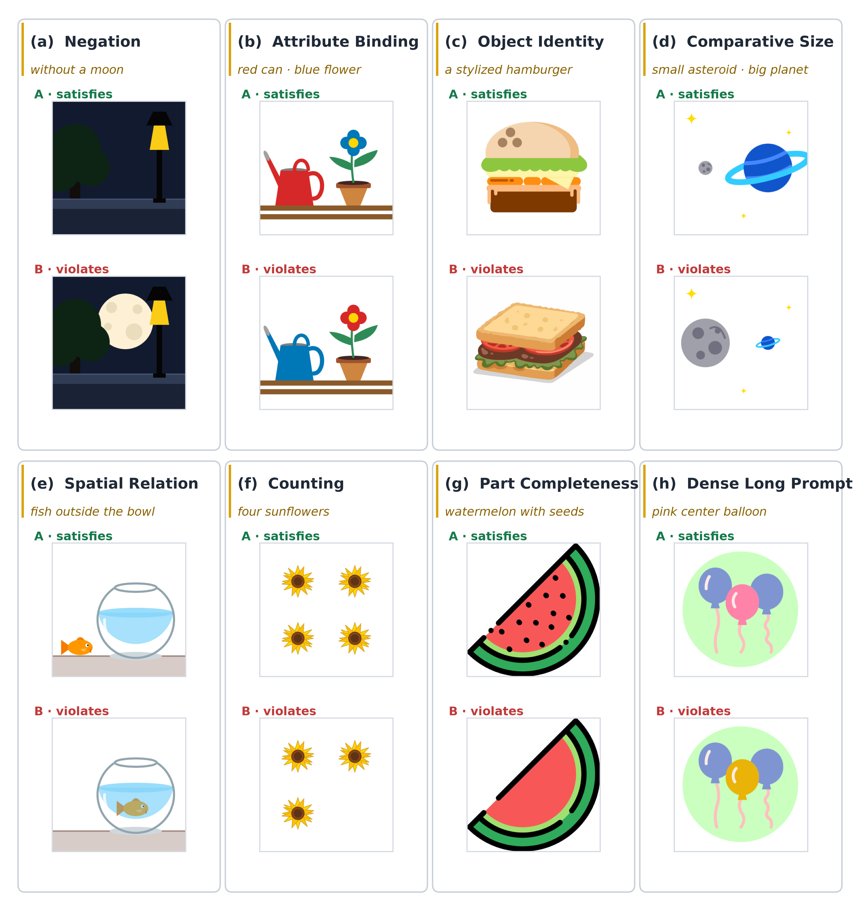

# SVGFaith

SVGFaith: A Two-Layer Meta-Evaluation of Faithfulness Metrics for Text-to-SVG Generation.

[](https://arxiv.org/abs/2611.06048)
[](https://huggingface.co/datasets/Yukinonooo/SVGFaith)
[](https://huggingface.co/Yukinonooo/SVGFaith-Decomposer)
[](LICENSE)



Text-to-SVG systems are usually evaluated by rasterising the SVG and running a raster metric such as CLIPScore or a vision-language judge. SVGFaith tests whether a metric actually prefers the more faithful candidate.

It has two layers:

- **SVGFaith-Diagnostic**: 1,842 controlled contrastive pairs across eight capability axes, split into 921 image-side pairs and 921 text-side pairs.
- **SVGFaith-Arena**: 1,327 human comparisons of real outputs from six text-to-SVG generators.

We also release **SVGFaith-Score**, an interpretable pointwise metric.

## Results

Pairwise accuracy from Table 2 of the paper. Diagnostic columns are unweighted means of the eight axes. Ties receive no credit.

| Method | Arena (τ=0) | Arena (τ=0.01) | Diagnostic image (τ=0) | Diagnostic image (τ=0.01) | Diagnostic text (τ=0) | Diagnostic text (τ=0.01) |
|---|---:|---:|---:|---:|---:|---:|
| CLIP-L/14 | 0.769 | 0.699 | 0.660 | 0.470 | 0.658 | 0.328 |
| SigLIP-L/16-384 | 0.823 | 0.775 | 0.750 | 0.517 | 0.745 | 0.462 |
| Long-CLIP-L/14 | 0.791 | 0.739 | 0.713 | 0.481 | 0.754 | 0.376 |
| Qwen3-VL-Embedding-8B | 0.861 | 0.843 | 0.777 | 0.717 | 0.799 | 0.668 |
| PickScore v1 | 0.833 | 0.605 | 0.799 | 0.313 | 0.737 | 0.149 |
| HPS v2.1 | 0.841 | 0.769 | 0.808 | 0.540 | 0.703 | 0.368 |
| ImageReward v1.0 | 0.824 | 0.819 | 0.784 | 0.779 | 0.782 | 0.767 |
| FlanT5-XXL VQAScore | 0.798 | 0.784 | 0.873 | 0.824 | 0.878 | 0.825 |
| LLM-as-a-Judge (122B) | 0.754 | 0.754 | 0.902 | 0.902 | 0.857 | 0.857 |
| **SVGFaith-Score** | **0.898** | **0.880** | **0.965** | **0.941** | **0.966** | **0.953** |

Mean individual-annotator agreement with the final Arena labels is **0.875**.

Reproduce the SVGFaith-Score rows from the released per-pair scores:

```bash
python -m svgfaith.evaluate scores/arena.jsonl scores/diagnostic_image.jsonl scores/diagnostic_text.jsonl
python -m svgfaith.evaluate --tau 0 scores/arena.jsonl scores/diagnostic_image.jsonl scores/diagnostic_text.jsonl
python -m unittest tests.test_aggregate
```

At τ=0.01 on Arena, the released scores are 1,168 wins, 37 ties, and 122 losses.

## How SVGFaith-Score works



1. [`Yukinonooo/SVGFaith-Decomposer`](https://huggingface.co/Yukinonooo/SVGFaith-Decomposer) reads only the prompt and emits a directed acyclic graph of atomic visual requirements. It is a Qwen3.5-9B model trained with teacher distillation, rejection-sampling SFT, and GRPO. Its system prompt is [`svgfaith/prompts/decomposer_system.txt`](svgfaith/prompts/decomposer_system.txt).
2. The unmodified [`Qwen/Qwen3.5-9B`](https://huggingface.co/Qwen/Qwen3.5-9B) answers each requirement on one rendered image with thinking disabled. Questions are phrased so that Yes means the requirement is satisfied. We read the first answer token and renormalise over Yes and No: `P(Yes) / (P(Yes) + P(No))`.
3. Unique-ancestor gating in [`svgfaith/aggregate.py`](svgfaith/aggregate.py) discounts a requirement when its prerequisites score low, with α = 0.5. Each distinct ancestor is counted once.

## The eight diagnostic axes



| Axis | Image-based | Text-based | Total |
|---|---:|---:|---:|
| Negation | 123 | 123 | 246 |
| Attribute binding | 121 | 122 | 243 |
| Comparative size | 124 | 124 | 248 |
| Spatial relation | 123 | 122 | 245 |
| Object identity | 123 | 118 | 241 |
| Counting | 103 | 100 | 203 |
| Part completeness | 101 | 112 | 213 |
| Dense long prompt | 103 | 100 | 203 |
| **Total** | **921** | **921** | **1,842** |

## Benchmark download

The benchmark is hosted on Hugging Face, not inside this git repository:

```bash
huggingface-cli download Yukinonooo/SVGFaith --repo-type dataset --local-dir svgfaith-data
```

`diagnostic/manifest.jsonl` indexes the 1,842 diagnostic pairs (1,799 kept by all three annotators and 43 added by expert review). `arena/pairs.jsonl` and `arena/images/` hold the 1,327 Arena comparisons from OmniSVG1.1-8B, InternSVG-8B, SVGen, GPT-5.4, Gemini-3.1-Pro, and Claude-Opus-4.6.

## Citation

```bibtex
@misc{liang2026svgfaith,
  title = {SVGFaith: A Two-Layer Meta-Evaluation of Faithfulness Metrics for Text-to-SVG Generation},
  author = {Liang, Guotao and Zhou, Haitao and Liu, Biao and Liao, Huanxuan and Qiao, Lingfeng and Zhang, Qian-Wen and Yu, Qian and Yin, Di and Sun, Xing},
  year = {2026},
  eprint = {2611.06048},
  archivePrefix = {arXiv},
  primaryClass = {cs.CV},
  url = {https://arxiv.org/abs/2611.06048}
}
```

## License

Code is under the [Apache License 2.0](LICENSE). The benchmark and released scores are under [CC BY 4.0](DATA_LICENSE).
